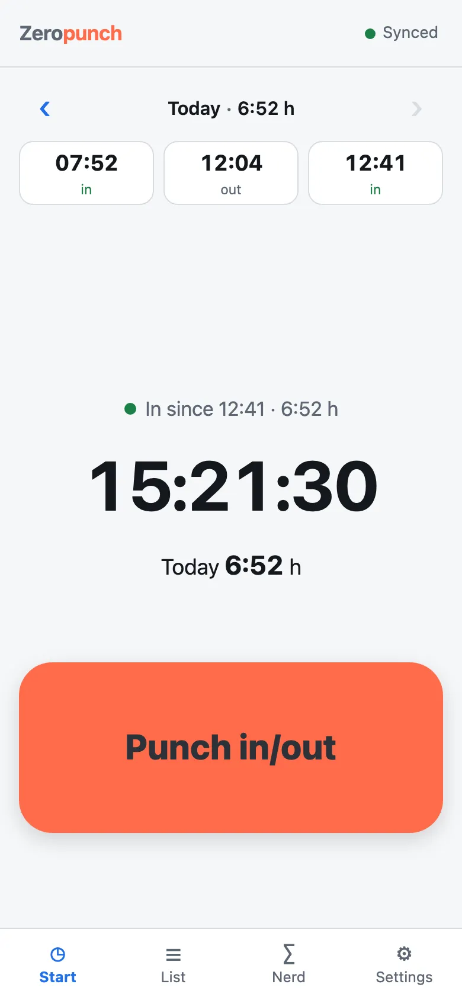

# Zeropunch

**A punch clock that knows nothing about you.**

Open the app: [zeropunch.app](https://zeropunch.app) · About Zeropunch: [zeropunch.dropnook.app](https://zeropunch.dropnook.app)

<picture>
  <source media="(prefers-color-scheme: dark)" srcset="docs/screenshots/start-en-dark.webp">
  
</picture>

Zeropunch is a punch clock for your phone: one button, «Punch in/out», and a list of your times. Every
punch is encrypted in the browser before it leaves the device. The server stores ciphertext of one fixed
size and never sees a working time, a note or your username in clear. No e-mail address, no real name.

It runs as a small serverless backend (one function for the API, a SQL database) and a static,
build-free client (HTML, CSS, ES modules, no runtime dependencies, nothing loaded from other origins).
English and German. Design notes (German): [KONZEPT.md](KONZEPT.md).

## Features

- **Punches** are points in time. Within a day they pair up in order (in, out, in, …); the day total
  is the sum of the pairs. Optional *night shifts* move the day change (e.g. to 04:00) so a shift over
  midnight stays one day.
- **Start screen:** state, clock, the big button and one day's punches (swipe back day by day). No
  banner after a punch: the new chip glows. **List:** days and weeks against the weekly target.
- **Absences:** vacation, sick, public holiday or other, whole or half day. They credit the day's
  target (weekly target / 5 per weekday, half of that for a half day, nothing on weekends).
- **Week and month sheets** for printing or saving as PDF. **Export** as CSV or JSON.
- **Punch link for an NFC sticker:** `/#punch` punches at once (nothing within a minute of the last
  punch), syncs at once and closes the browser tab where the browser allows. With «Punch link without
  asking» switched off, or when the link is opened from another web page, it asks «Punch now?» first. On iPhone the link opens the default browser, not the home-screen app.
- **Badge reminder** (off by default, every 25 days when on): a note to validate your badge.
- **16 punch animations** (random by default, or one of them, or off; none with «reduce motion»).
- **Offline first:** installable app, punches wait in an outbox. An installed app looks for a new
  version once a day and loads it by itself.
- **Account:** username (3–32 characters, `a–z 0–9 . _ -`) and passphrase (at least 6 characters,
  warning below 10). The username is shown at the top of the settings.

## What the server sees

| The server sees | The server never sees |
|---|---|
| an HMAC of your username (the name itself only in transit, at register and login) | your username at rest |
| an HMAC of `authKey`, the wrapped master key (stored encrypted under `PEPPER`) | passphrase, `wrapKey`, master key |
| ciphertext of one fixed size per record (379 characters; nothing else is accepted) | times, notes, absences, settings |
| when an encrypted record arrives (stored only as the UTC day of its last write) | what it contains |
| your IP address, transiently, as a keyed hash in rate-limit counters deleted within two days | – |

Per account the database keeps only days (creation, last use, last write of each record, session
expiry), a sync counter and the record count; no time of day. Per-account rate-limit counters use
their own HMAC and cannot be joined to an account without `PEPPER`.

Keys: `PBKDF2-SHA-256(passphrase, salt = SHA-256("zeropunch kdf v1|" + username), 600 000)`, split
with HKDF into `authKey` (sent to log in) and `wrapKey` (never leaves the device). A random 256-bit
master key, wrapped only with `wrapKey`, encrypts every record with AES-256-GCM (plaintext padded to
256 bytes, additional data = username + record id). On the device the master key is a
non-extractable WebCrypto key. Sync: the larger `mod` wins.

## Honest limits

1. **You must trust the JavaScript the server delivers.** No third-party code, strict CSP, no build step.
2. **Arrival times.** The server sees when a record arrives; punching without a network blurs that.
3. **A lost passphrase cannot be recovered**: no recovery key, no e-mail reset, no support.
4. **Usernames are not secret**: registering reveals whether a name is taken. Don't use your name.
5. **Offline guessing** needs the database **and** `PEPPER`, at 600 000 PBKDF2 rounds per guess.
6. **Backups at the database provider** keep deleted data restorable for up to 30 days.
7. **The master key is never rotated**; a passphrase change re-wraps the same key.
8. **Other instances:** reusing username and passphrase elsewhere hands that operator your `authKey`.
9. **The server can withhold or roll back** records or drop writes; it cannot read or forge them.

## Limits and retention

- **13 months:** punches and absences live 396 days; the app drops older ones and deletes them on the
  server, and a daily job deletes records not written for 396 days as a backstop.
- **61 days without use:** the account is deleted with all records and sessions. No recovery, no e-mail.
- **12 punches per day** in the app (an absence takes one place); the server accepts **100 record
  writes per account and UTC day**, then `429 daily_limit` and the writes wait until the next day.
- **5000 records per account**, fixed record size, at most 20 sessions, request bodies at most 8 KiB.
- **Abuse brakes** per IPv4 address or IPv6 /64 (and ten times higher per /48): proof of work and
  100 registrations per network and day, 300 failed logins per network and hour (generous, so people
  behind one shared office or mobile address do not lock each other out), attacked accounts need
  a proof of work instead of being locked. Details in [KONZEPT.md](KONZEPT.md).

## Self-hosting

Zeropunch runs on Cloudflare: a Worker (API, static files, daily Cron Trigger) and a D1 database. You
need an account there and Node.js with npm.

```sh
git clone https://github.com/dropnook/zeropunch.git && cd zeropunch
npm install
npx wrangler login
npx wrangler d1 create zeropunch          # put the printed database_id into wrangler.jsonc
openssl rand -base64 48 | npx wrangler secret put PEPPER
npx wrangler d1 migrations apply zeropunch --remote
npx wrangler deploy
```

- `PEPPER` is the server secret for all HMACs. **Never change it:** account ids, auth hashes and
  rate-limit counters depend on it; a new value locks everybody out.
- **Domain:** `wrangler.jsonc` has a custom-domain route for the official instance. Put in your own
  host name (the zone must be on Cloudflare), or remove `routes` and set `"workers_dev": true`. No host
  name is hard-coded elsewhere, except `public/_redirects` (`/about` → product site): keep, change or
  delete it.
- Only `/api/*` runs through the Worker (`run_worker_first`); static files are served directly with
  the headers from `public/_headers` (kept equal to `src/headers.js` by a test).
- The Cron Trigger (`17 3 * * *`) runs the daily retention job.
- **New version:** `npx wrangler d1 migrations apply zeropunch --remote`, then `npx wrangler deploy`.
  Coming from 2.3 or older: deploy first, then apply `0003_no_recovery_key.sql` right away. After
  changing anything in `public/`, bump `CACHE_VERSION` in `public/sw.js`.

### Variables and secrets

| Name | Kind | Purpose |
|---|---|---|
| `PEPPER` | secret | server secret for HMACs (usernames, auth keys, IPs, challenges) |
| `POW_BITS` | var | proof-of-work difficulty at registration, default `17` |
| `REG_PER_IP_DAY` | var | registrations per client network and day, default `100` (ten times that per IPv6 /48) |
| `REG_GLOBAL_DAY` | var | registrations per day above which the proof of work gets harder, default `1000` |
| `REG_GLOBAL_MAX_DAY` | var | hard ceiling of registrations per day overall, default `5000` |
| `STATS_TOKEN` | secret, optional | bearer token for `GET /api/admin/stats`; without it the route answers 404 |
| `DB` | D1 binding | database `zeropunch` |
| `ASSETS` | assets binding | `public/` |

### Operator statistics (optional)

```sh
openssl rand -base64 32 | npx wrangler secret put STATS_TOKEN
curl -s -H "Authorization: Bearer $STATS_TOKEN" https://<your-host>/api/admin/stats
```

The answer holds totals only (accounts, seen in 7/30 days, idle over 45 days, records, sessions,
registrations today, database size, version), never an id or a row of one account. A missing or wrong
token gets the same `404` as an unknown route, after the same database work; 10 requests without the
right token per network and hour, then only 404s.

### Local development

```sh
cp .dev.vars.example .dev.vars           # local PEPPER only; .dev.vars is git-ignored
npm run db:migrate:local                 # = wrangler d1 migrations apply zeropunch --local
npm run dev                              # = wrangler dev → http://localhost:8787
curl "http://localhost:8787/cdn-cgi/handler/scheduled?cron=17+3+*+*+*"   # run the daily job
```

The session cookie `__Host-zp` is `Secure`: Chrome and Firefox accept it on `http://localhost`, Safari
does not. The API answers plain http only on `localhost`, `127.0.0.1` and `[::1]`.

## Development and tests

```sh
npm test                             # unit tests (test/unit) and backend tests (test/worker)
node scripts/sync-demo.mjs --check   # the product site's demo copies of the punch animations
```

After changing the punch animations (`public/js/punchfx.js`, `fx.js`, `dom.js`, `public/punchfx.css`,
`public/fx/`), run `node scripts/sync-demo.mjs`. PNG icons: `node scripts/make-icons.mjs`.

## Renaming

The visible name appears in exactly these places:

- `public/js/i18n.js`: `APP_NAME`, `WORDMARK` (the two-tone logo text) and `REPO_URL`
- `public/index.html`: `<title>`, the meta description and the boot/noscript text
- `public/manifest.webmanifest`: `name`, `short_name`, `description`
- `public/icons/icon.svg` (`<title>`) and the icon PNGs (`scripts/make-icons.mjs`)

Internal identifiers (IndexedDB name, cookie, cache name, KDF strings, export format ids, backend and
database names) also carry the name; changing them is optional, and changing the KDF strings or the
cookie logs everybody out or makes existing accounts unreadable.

---

<sub>Zeropunch is free software under the [GNU Affero General Public License v3.0](LICENSE) (AGPL-3.0-only);
the names Zeropunch™ and Dropnook™ are not part of that license — see [TRADEMARKS.md](TRADEMARKS.md).</sub>
